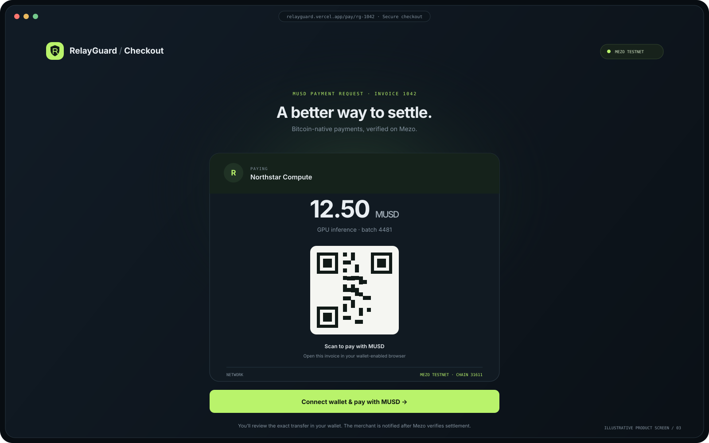
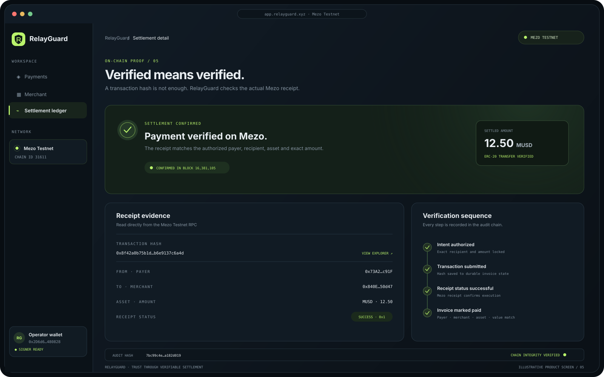

# RelayGuard
## MUSD payments with protocol-aware controls

**Wave 2 · Mezo Testnet**

Praise · Solo builder

QR checkout for people. x402 access for agents. A Mezo-native spending policy for both.

---

## MUSD needs a safer path into everyday commerce

- Merchants need a simple way to quote, collect, and verify MUSD.
- Agents need exact, machine-readable payment terms before a protected API releases value.
- A generic ERC-20 transfer does not account for the Bitcoin-backed borrowing position that may sit behind an operator's MUSD treasury.

**RelayGuard connects the payment to the policy and the relevant Mezo protocol state.**

---

## One merchant destination. Two ways to pay.

*Illustrative product screen; not a captured live transaction.*

- **People:** shareable invoice and QR; buyer signs the exact MUSD transfer.
- **Agents:** x402 exact terms; facilitator settles before API access.
- Both pay the merchant directly; RelayGuard never holds checkout funds.

---

## The Wave 2 difference: policy reads Mezo trove health

RelayGuard reads the configured operator's trove status, Mezo `PriceFeed`, and protocol-computed ICR.

| Observed ICR | MUSD agent-payment decision |
|---|---|
| At least 150% | Configured transaction and daily limits |
| 110% to below 150% | Human approval for every positive payment |
| Below 110% | Block authorization, approval, and execution |
| Read unavailable | Fail closed for MUSD; BTC policy unchanged |

150% is RelayGuard's review buffer; 110% is Mezo's minimum. These operator controls never open a trove or borrow/add collateral.

**Status:** deployed policy; 45 automated tests pass, including controlled threshold and RPC-failure cases. The new buyer checkout preflight and optional Testnet trove-opening flow are implemented but not yet manually wallet-tested; no borrow transaction was broadcast for this feature.

---

## Every policy decision is auditable

- The PriceFeed, trove status, ICR, collateral, and debt reads use the same Mezo block.
- Each authorization retains the borrower, price, risk tier, ICR, collateral, debt, block number, and observation time.
- The hash-linked audit chain commits the policy and evidence digests; tampered stored evidence fails verification.
- Approval and execution stop if the risk tier changes. Operators can cancel stale requests; reviewers may still reject them.

The policy uses the operator's trove as a spending signal; it does not open or modify that trove. Separately, an underfunded buyer may opt into a Testnet-only, wallet-confirmed trove-opening flow. Borrowing and invoice payment require separate reviews and transactions; production wallet testing remains outstanding.

---

## Reliability is part of payment safety

*Illustrative product screen; see the linked test evidence for actual settlement records.*

- Invoice/receipt waits time out with retry; verification stops after 20 checks.
- Payment-in-progress guidance discourages duplicate payment.
- Changed trove risk blocks stale approval/execution; cancel and submit fresh.

**Status:** deployed; production failure-mode testing remains outstanding.

---

## Evidence from Mezo Testnet

- **1.00 MUSD invoice:** settled to the configured merchant and verified against the exact token transfer.
- **0.001 MUSD x402 resource:** facilitator settlement was verified; the protected resource was returned.
- Both historical payments reached the same merchant receiver.
- **45 automated tests pass locally**, including protocol-risk boundaries, receipt verification, authorization lifecycle, and x402 typed-data signing.

Full transaction references and test limitations: [test results](./TEST_RESULTS.md). These are testnet results, not mainnet production evidence.

---

## Business model — proposed, not yet enabled

**Free pilot** for initial merchants, followed by:

- **$19/month** for a merchant workspace with invoices, policy controls, audit history, and agent/API configuration.
- **0.5% fee** on successfully settled MUSD invoices, disclosed before merchant activation.

These are planning assumptions, not current product charges. RelayGuard does not currently collect a platform fee; checkout settlement goes directly to the configured merchant. Validate willingness to pay and unit economics with pilot merchants before enabling billing.

---

## Team

**Praise — solo builder**

Product ownership and implementation of RelayGuard's merchant checkout, agent-payment flow, Mezo integration, and submission materials.

**Ask:** feedback and mentorship on merchant adoption, safe treasury policy design, and the path from testnet demo to production-grade payment operations.

---

## RelayGuard

### Make MUSD usable. Make agent spending accountable.

[Live app](https://relayguard.vercel.app) · [Product strategy](./PRODUCT_STRATEGY.md) · [Test evidence](./TEST_RESULTS.md)

**Mezo Testnet · Chain ID 31611**
